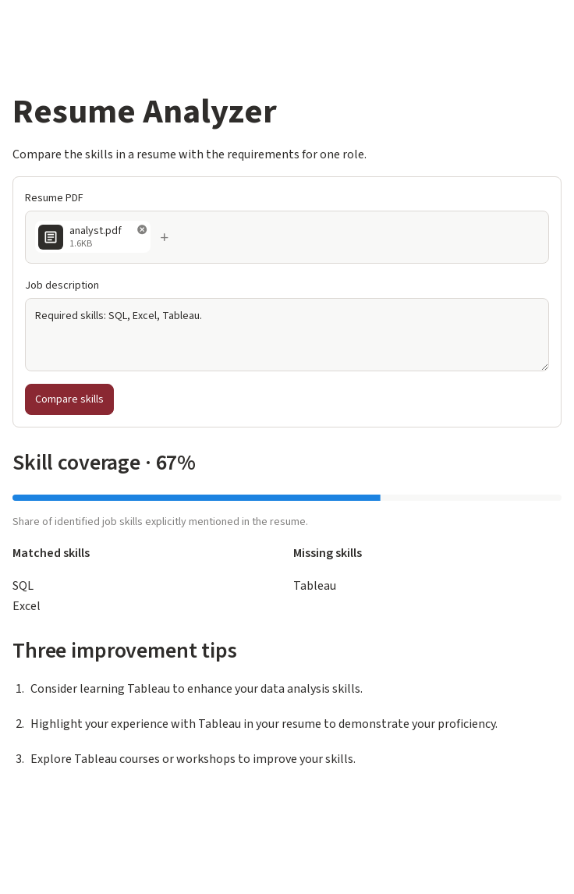
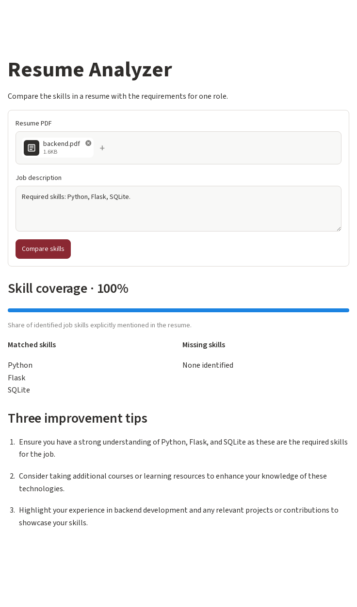

# Resume Analyzer · PS41

Compare a text-based resume PDF with a pasted job description. The app shows a percentage progress bar, matched skills, missing skills and three suggested improvements. Designed as a Gen AI mini project for roll 41.

## Run locally in VS Code (Windows)

1. Install Python 3.12 or 3.13 and [Ollama](https://ollama.com/download). Open Ollama on Windows and leave it running.
2. Extract the ZIP. Open the folder containing **app.py** in VS Code and open Terminal → New Terminal.
3. Download the local model once:

   ```powershell
   ollama pull qwen2.5:1.5b
   ```

4. In the same terminal create the environment and launch Streamlit. These commands use the Python launcher and work without activating PowerShell scripts.

   ```powershell
   py -m venv .venv
   .\.venv\Scripts\python.exe -m pip install -r requirements.txt
   .\.venv\Scripts\python.exe -m streamlit run app.py
   ```

5. Open the local address printed by Streamlit. Try **samples/analyst.pdf** with **Required skills: SQL, Excel, Tableau.** Click **Compare skills**. Other fictional PDFs and their job descriptions are in **samples/cases.json**.

## How it works

PyPDF2 extracts selectable text. A first model call extracts skill phrases from the job description. Python discards phrases absent from the job and checks each remaining phrase against the resume using case-insensitive boundaries. Coverage is the rounded percentage of these distinct phrases present. A second model call receives both documents and verified groups, and is prompted for JSON containing the score, two skill lists and exactly three tips. The display uses the independently checked score and lists. A missing skill means its wording was not located; it does not establish a person's ability. Only use suggestions supported by real experience.

**Limits:** Scanned PDFs require OCR outside this project. Exact phrases can miss synonyms and negation. Model extraction can omit a requirement or give generic advice. Keep the local model running; large inputs have explicit size limits. No cloud API key is required.

## Model and testing

The app defaults to Ollama at `http://127.0.0.1:11434/v1`. The captured runs used Qwen2.5-1.5B-Instruct Q4_K_M through a local llama.cpp server implementing the same chat-completions interface. To use a different local compatible server, set `LLM_BASE_URL` (including `/v1`) and `LLM_MODEL` before launching Streamlit. Both the pilot responses and the five-case final comparison are in **tests/**. Screenshot outputs may phrase tips differently on separate runs.

## Sample outputs




